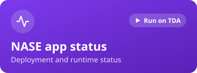
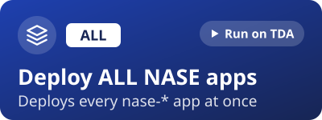
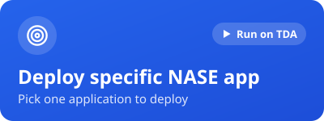
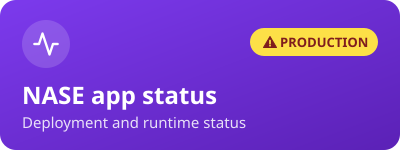
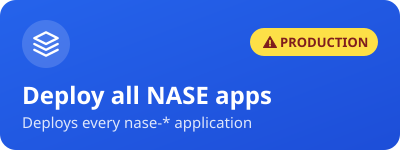
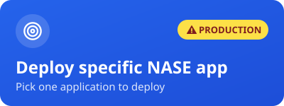
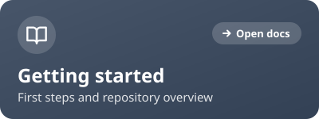

  <picture>
    <source media="(prefers-color-scheme: dark)" srcset="assets/readme/f5-header-dark.svg">
    <source media="(prefers-color-scheme: light)" srcset="assets/readme/f5-header-light.svg">
    
  </picture>

## 🔀 Actions

### 🟢 TDA

  

    
  

  

    
    &ensp;
    
  

  

    
  

### 🔴 PROD

  

    
  

  

    
    &ensp;
    
  

  

    
  

## 📚 Documentation

  
  &ensp;
  

